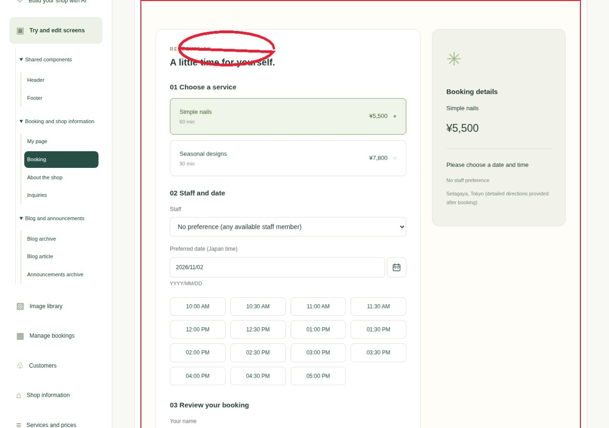
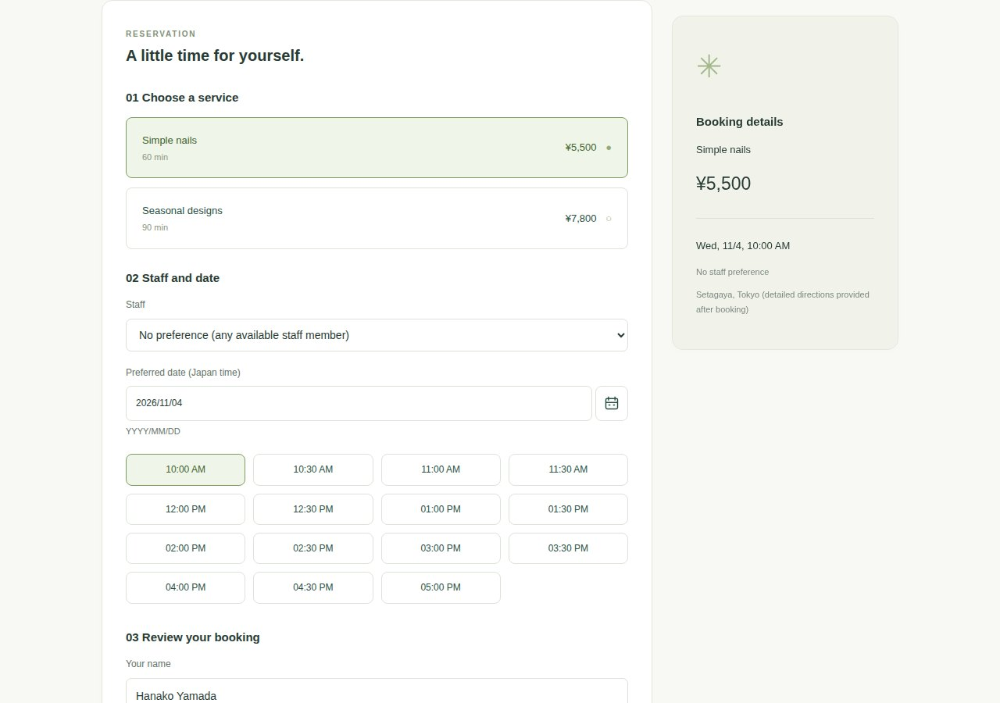

# gemihub

[English](README.md) · [日本語](README_ja.md)

**Ask AI to build and run your shop's system the same way you would ask a person.**

A booking and shop management system for small independent businesses and salons. No technical configuration jargon required—talk through what kind of shop you want, circle an area on the screen with a pen to say "change this part," review the preview, and publish when you're ready.

## Screenshots

**Point and ask:** Circle the part of the screen you want to change, tell AI what you want, and preview the result before applying.



**Customer booking:** Choose a service, staff preference, and available time slot.



---

## What You Can Do

### 1. Ask AI the Same Way You Ask a Person
- **Set up by conversation:** Describe your business type and desired features by text or voice; AI asks follow-up questions and proposes the screens your shop needs.
- **Fill settings from notes or URLs:** Use **Set up with AI** in shop, service, staff, hours, and booking-rule settings. Review the suggested values, apply them to the form, then save.
- **Circle on screen with a pen:** Draw a circle around any part of a preview screen and ask by text or voice to adjust text, layout, or styling—just like pointing at a screen with a designer.
- **Consult by voice or chat:** Ask the shop assistant questions like "What is our current refund policy?" or discuss rule changes via live voice (Gemini Live) or chat to prepare a change request.
- **Request photos and blog posts in plain words:** Ask AI to generate custom images for services and pages, or draft blog posts and announcements.

### 2. Bookings, Payments, and Staff Sync
- **Smart availability calculation:** Automatically computes open slots from business hours, holidays, staff shifts, and service durations (with or without staff preference).
- **Google Calendar integration:** Owner sign-in requests Calendar FreeBusy access alongside Drive and Gmail. No staff registration is required for the owner; their Calendar busy times are checked automatically. A shop can start with no additional staff. Other staff grant Calendar access through their staff login.
- **Add-on services:** Configure removal or care as an optional addition to selected services. Prices and durations are combined for availability, booking and payment; options in the same group are mutually exclusive.
- **Weekday opening hours:** Keep normal hours and override individual weekdays, such as closing at 19:00 normally and 21:00 on Tuesdays and Fridays.
- **PayPal prepayment & automated refunds:** Accept PayPal payments at booking time and automatically calculate refunds upon cancellation based on your shop's policy.
- **Cancellations and refunds:** Cancelling an eligible paid booking automatically accepts a replacement reservation. If someone books, the refund increases; before payment starts, the customer can undo the cancellation. New customers see discounted appointments they can book at the displayed price.

### 3. Daily Operations & CRM
- **Booking & inquiry management:** Track daily reservations by staff or date, reply to customer inquiries via email, and track resolution status.
- **Customer records (CRM):** Automatically aggregate visit counts and spending by customer, and attach private operator notes and photos.
- **Bilingual interface:** Switch between Japanese and English across management screens, customer pages, and the illustrated manual.
- **JP/US support:** Choose your shop's currency and time zone independently of the interface language. See the [language and region guide](docs/i18n.md).

---

## How It Works

```
[Owner / Staff / Customer]
         │
         │ (Voice, chat, or pen-marked screen captures)
         ▼
   [ gemihub Server ] ── (Intent understanding, proposals, images) ──► [ Vertex AI (Gemini) ]
     │            │
     │            └── (Business data, sessions, locks) ──────────► [ Cloud Firestore ]
     │
     └── (Images, attachments, specs, exports) ────────────► [ Owner's Google Drive ]
```

- **Multimodal proposals for pages, articles, and settings—with server-enforced booking & payment logic:**
  Gemini on Vertex AI understands natural conversation, live voice, and pen-marked screenshots to draft page structures, Markdown copy, layouts, images, and shop settings. Meanwhile, authentication, access control, availability calculation, and payment amounts are strictly enforced by the server.
- **Theme creation and review:**
  Initial setup asks for your shop name and logo, with separate choices for blog, announcements, staff introduction, and products/services. AI builds an HTML/CSS theme from reference images, then an independent AI review checks it with up to three repair attempts. Reference-page images guide the design; explicitly requested logos and photos are displayed. Use the red pen to revise the first theme preview.
- **Source-backed answers and a Propose → Preview → Approve workflow:**
  In **Consult & ask**, a dedicated research LLM checks the system docs, the shop's `spec.md`, `history.md`, and live ledger records to answer with sources—explicitly stating when something is not defined instead of guessing. Change requests only go live after the owner previews the diff and approves on screen, recording the request in `history.md`.
- **Data storage and export:**
  Business data (settings, bookings, customers, inquiries, articles, and AI chats) lives in **Firestore**. Owners can download a JSON export or CSV tables from **Publication settings**. Images, attachments, specs, history, and offline HTML exports remain in the owner's **Google Drive**; exported records include file references, not the file bytes.

---

## Getting Started

Requires Node.js 24 or later.

### 1. Try Locally (Demo Mode)

You can try the salon demo with in-memory data and form-based editing without Google Cloud or OAuth credentials. Free-form questions, pen editing, and natural-language changes require a Vertex AI connection.

```sh
npm ci
cp .env.example .env
npm run build
npm start
```

Open http://localhost:3000 and click **Try the salon demo** (use http://localhost:3000/?lang=en for English).

- For development with hot reload, run `npm run dev` (server) and `npm run dev:web` (Vite at http://localhost:5173) in separate terminals.
- To browse all screens with isolated mock data, run `npm run storybook` (http://localhost:6005).
- Cancellation stories are under **Customer screens → Cancellations and discounted appointments** and **Management → Bookings and customers → Replacement bookings** (15 states). Cancellation, undo, payment confirmation and refund retry are simulated. After `npm run build-storybook`, run `npm run check:storybook:transfers` to check their interactions in Japanese/English and desktop/mobile widths; set `CHROMIUM` to an installed browser path if needed.

### 2. Connect Google and Vertex AI

To use real AI generation and Firestore and Google Drive storage, enable the following APIs in your Google Cloud project and configure Application Default Credentials (`gcloud auth application-default login`):

- Vertex AI API / Cloud Firestore API
- Google Drive API / Gmail API / Google Calendar API

Update `.env` (see `.env.example` for all options):

| Variable | Purpose |
| --- | --- |
| `DEMO_MODE=false` | Disable demo mode and use real Google / AI integrations |
| `SESSION_SECRET` | Random secret (32+ characters) used for sessions and token encryption |
| `GOOGLE_CLOUD_PROJECT` | Google Cloud project ID |
| `GOOGLE_CLOUD_LOCATION` | Vertex AI location (e.g., `us-central1`) |
| `VERTEX_MODEL` | Gemini model ID on Vertex AI |
| `VERTEX_REVIEW_MODEL` | Optional first-theme review model; defaults to `VERTEX_MODEL` in a fresh context |
| `GOOGLE_CLIENT_ID` / `GOOGLE_CLIENT_SECRET` | Web application OAuth credentials (redirect URI: `${APP_ORIGIN}/auth/google/callback`) |
| `APP_ORIGIN` | Management origin (e.g., `http://localhost:3000` locally) |

For PayPal Sandbox testing, also set `PAYPAL_ENVIRONMENT=sandbox`, `PAYPAL_CLIENT_ID`, and `PAYPAL_CLIENT_SECRET_FILE`.

---

## Documentation & Testing

- **Illustrated manual:** Open `/manual` in the app, or browse the manual story in Storybook.
- **Detailed docs:**
  - Specification: [docs/spec.en.md](docs/spec.en.md) ([日本語](docs/spec.md))
  - System reference: [docs/system/index.md](docs/system/index.md)
  - Terraform deployment: [infra/README.md](infra/README.md) ([日本語](infra/README_ja.md))
- **Run tests:** `npm test`

## License

[MIT](LICENSE) © 2026 takeshy. Third-party notices are listed in [THIRD_PARTY_NOTICES.md](THIRD_PARTY_NOTICES.md).
