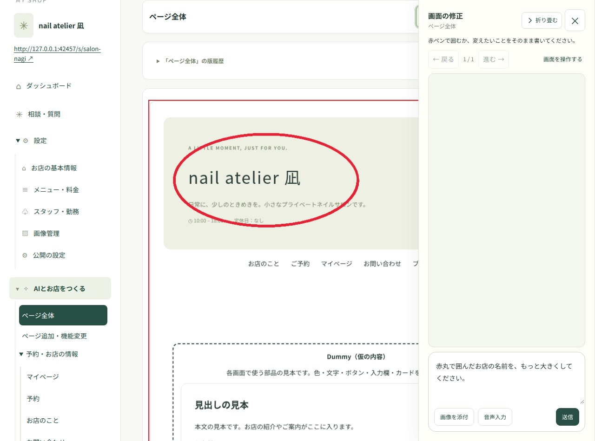
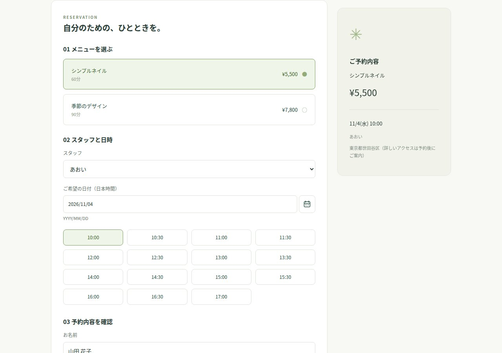

# gemihub

[English](README.md) · [日本語](README_ja.md)

**人に頼むのと同じやり方で、AIにお店のシステムを頼める。**

個人商店・サロン向けの予約・店舗運営システムです。設定画面の専門用語を覚える必要はありません。制作担当者に相談するように「こんなお店にしたい」と話し、画面の気になる場所をペンで囲んで「ここを直して」と伝えるだけで、AIが画面案をつくり、確認してから公開できます。

## 画面イメージ

**画面を指さして頼む：** 変更したい箇所をペンで囲んで「ここをこう変えて」と伝え、プレビューで確認してから反映できます。



**お客様が予約する：** メニュー・スタッフ・空き時間を選び、そのまま予約できます。



---

## なにができるか

### 1. 人に頼むのと同じやり方で、AIにお店づくりを頼める
- **会話でお店を立ち上げ：** 業種やほしい機能をチャットや音声で伝えるだけで、AIが聞き取りながら必要な画面構成を提案します。
- **画面をペンで囲んで「ここを直して」：** プレビュー画面の気になる箇所をペンで丸く囲み、言葉や音声で指示するだけでデザインや文言を修正できます。
- **声やチャットで相談・質問：** 「今のキャンセル規定はどうなってる？」「来月からルールを変えたい」など、お店のアシスタントに音声（Gemini Live）やチャットで相談し、変更の依頼文をまとめてもらえます。
- **写真や記事も言葉で依頼：** メニューやページに使う画像の生成や、ブログ・お知らせ記事の下書き作成もAIに頼めます。

### 2. 予約受付・決済・スタッフ連携
- **柔軟な予約枠計算：** 営業時間・定休日・臨時休業・スタッフのシフト・メニューの所要時間から空き枠を自動で計算します（スタッフ指名・指名なしの両方に対応）。
- **Google カレンダー連携：** スタッフが自分の Google アカウントを連携すると、カレンダーの予定（FreeBusy）を考慮して重複予約を防ぎます。
- **PayPal 事前決済と自動返金：** 予約時の PayPal 決済と、キャンセル規定（何時間前なら何％返金など）に基づく自動返金に対応しています。

### 3. 日々の店舗運営と顧客管理（CRM）
- **予約・お問い合わせ管理：** 日付やスタッフ別の予約確認、お問い合わせへのメール返信と対応状況の管理ができます。
- **お客様カルテ（CRM）：** 来店履歴や利用金額の自動集計、スタッフ専用の顧客メモ・写真添付・画像ギャラリーを利用できます。
- **日本語・英語対応：** 管理画面・お客様向け画面・マニュアルを日本語と英語で切り替えられます。
- **JP/US 対応：** お店の通貨・タイムゾーンを表示言語とは独立して選べます。詳細は[言語・地域の説明](docs/i18n.md)を参照してください。

---

## どういう仕組みか

```
[店主 / スタッフ / お客様]
         │
         │ (会話・音声・ペンで囲んだ画面キャプチャで依頼)
         ▼
   [ gemihub サーバー ] ── (意図の理解・変更案作成・画像生成) ──► [ Vertex AI (Gemini) ]
     │            │
     │            └── (業務データ・セッション・排他ロック) ───────► [ Cloud Firestore ]
     │
     └── (画像・添付・仕様書・書き出しファイル) ────────────► [ 店主の Google Drive ]
```

- **マルチモーダルな対話で画面・記事・設定を提案（予約・決済・権限はサーバーが厳密に管理）：**
  店主が送った「話し言葉」「音声」「ペンで囲んだ画面キャプチャ」を Vertex AI の Gemini が読み取り、ページの構成・文章（Markdown）・デザイン・画像や店舗設定の変更案を作ります。一方、認証や権限境界・空き枠計算・決済金額の計算はサーバー側の固定ロジックで行うため、AIの出力によって予約や決済の安全性が損なわれることはありません。
- **テーマの作成と確認：**
  初回はお店名とロゴの有無を確認し、ブログ・お知らせ・スタッフ紹介・商品やサービス紹介を個別に選べます。AIが参考画像からHTML/CSSでテーマを作成し、独立したAIの確認と修正を最大3回行います。参考ページ画像はデザインの手がかりとし、掲載を依頼したロゴや写真は使います。最初のプレビューから赤ペンで修正できます。
- **根拠（出典）にもとづく相談と、「提案 → プレビュー確認 → 承認」フロー：**
  「相談・質問」では、調査用のLLMがシステムの仕様書・お店の `spec.md`・変更履歴 `history.md`・台帳の実データを調べて出典付きで回答し、書かれていないことは推測せず「書かれていません」と答えます。変更依頼も、店主が画面でプレビューや差分を確認して承認したときだけ本番に反映され、依頼文も `history.md` に記録されます。
- **データの保存と書き出し：**
  設定・予約・顧客情報・お問い合わせ・記事・AIチャットは **Firestore** に保存します。店主は **「公開の設定」** から全体をJSON、記録の種類ごとにCSVで保存できます。画像・添付・仕様書・変更履歴・オフラインHTMLは店主の **Google ドライブ** に残り、書き出しにはファイル本体ではなく参照が含まれます。

---

## 環境構築（ローカルで動かす）

Node.js 24 以上が必要です。

### 1. デモモードで試す（Google / クラウド設定不要）

認証やクラウド接続なしで、インメモリデータを使ったサロンデモとフォームでの編集を試せます。自由な質問への回答、ペン編集、自然言語での変更には Vertex AI の接続が必要です。

```sh
npm ci
cp .env.example .env
npm run build
npm start
```

http://localhost:3000 を開き、**「サロンのデモを試す」** を選択してください。

- 開発サーバーで動かす場合は、別々のターミナルで `npm run dev`（APIサーバー）と `npm run dev:web`（Vite: http://localhost:5173）を実行します。
- 各画面のカタログをモックデータで確認する場合は `npm run storybook`（http://localhost:6005）を実行します。

### 2. Google / Vertex AI を接続して動かす

実際のAI生成や Firestore・Google ドライブ連携を使う場合は、Google Cloud プロジェクトで以下の API を有効化し、Application Default Credentials（`gcloud auth application-default login`）を設定します。

- Vertex AI API / Cloud Firestore API
- Google Drive API / Gmail API / Google Calendar API

`.env` に以下の環境変数を設定して起動します（詳細は `.env.example` を参照）。

| 変数名 | 内容 |
| --- | --- |
| `DEMO_MODE=false` | デモモードを無効化し、実際の Google / AI 連携を使用 |
| `SESSION_SECRET` | 32文字以上のランダムな文字列（セッションとトークンの暗号化に使用） |
| `GOOGLE_CLOUD_PROJECT` | Google Cloud プロジェクト ID |
| `GOOGLE_CLOUD_LOCATION` | Vertex AI のロケーション（例：`us-central1`） |
| `VERTEX_MODEL` | 使用する Gemini モデル ID |
| `VERTEX_REVIEW_MODEL` | 初回テーマ確認用モデル（省略時は `VERTEX_MODEL` を独立した文脈で使用） |
| `GOOGLE_CLIENT_ID` / `GOOGLE_CLIENT_SECRET` | Google OAuth クライアントの認証情報（リダイレクトURI: `${APP_ORIGIN}/auth/google/callback`） |
| `APP_ORIGIN` | 管理画面のオリジン（ローカルでは `http://localhost:3000`） |

※ PayPal 決済を試す場合は、あわせて `PAYPAL_ENVIRONMENT=sandbox`、`PAYPAL_CLIENT_ID`、`PAYPAL_CLIENT_SECRET_FILE` を設定します。

---

## 詳細ドキュメント・テスト

- **画面付きマニュアル：** アプリ起動後に `/manual` を開くか、Storybook の「使い方」から参照できます。
- **仕様・インフラ構成：**
  - 詳細仕様：[docs/spec.md](docs/spec.md)（[English](docs/spec.en.md)）
  - システム構成ドキュメント：[docs/system/index.md](docs/system/index.md)
  - Terraform デプロイ手順：[infra/README_ja.md](infra/README_ja.md)（[English](infra/README.md)）
- **テストの実行：** `npm test`

## ライセンス

[MIT](LICENSE) © 2026 takeshy。サードパーティのライセンス表記は [THIRD_PARTY_NOTICES.md](THIRD_PARTY_NOTICES.md) を参照してください。
